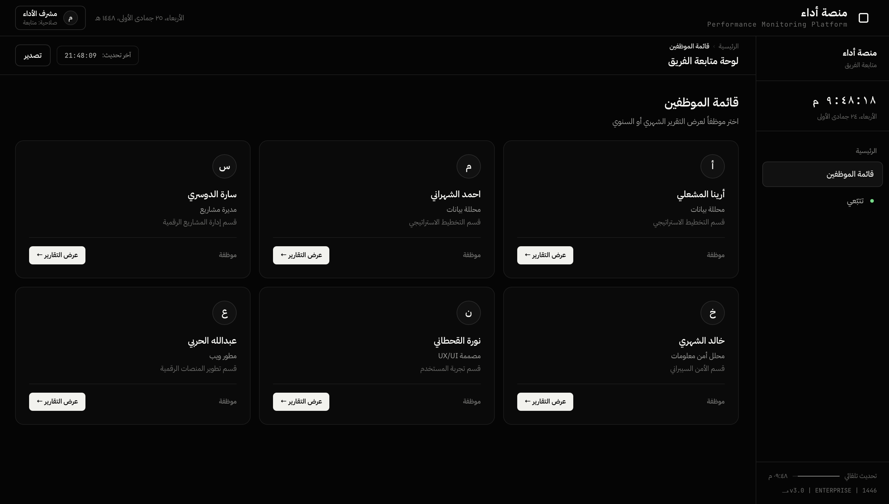
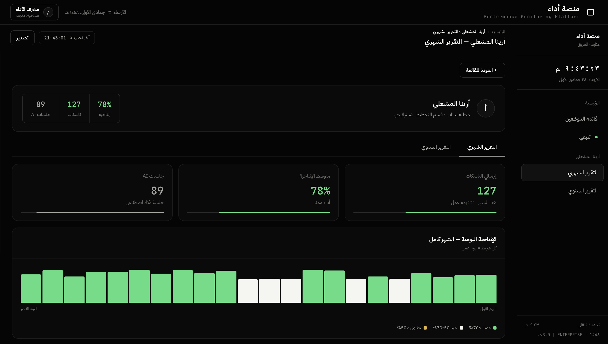

# Adaa | أداء
### Making Employee Contributions More Visible

Adaa is an AI-assisted employee performance insights platform developed as an **MVP during the Tuwaiq Hackathon**.

## The Problem

Traditional employee evaluations often rely on predefined targets or subjective managerial assessments. Both approaches can overlook actual contributions and the effort behind everyday work.

As workplaces increasingly rely on digital tools and AI, the way employees work is changing, while traditional evaluation methods do not always capture these changes.

This creates a gap between the work employees actually do and how their performance is evaluated.

## The Idea

We started with a question:

**What if everyday work activity could provide additional context for more objective employee performance evaluations?**

This led to Adaa: a platform that organizes selected digital work activity into structured information and uses AI to generate insights that can support better-informed performance discussions.

Adaa is designed to complement human judgment, not replace it.

## Key Features

- **Live Activity Tracking:** Monitors selected application activity and Excel workbook metadata on macOS.
- **Task Analysis:** Organizes activity into task records and progress indicators.
- **AI Insights:** Uses Google Gemini to generate summaries from selected task metadata.
- **Productivity Dashboard:** Visualizes daily activity, completed tasks, and productivity indicators.
- **Historical Records:** Maintains locally stored records for historical comparisons.

## Platform Preview

## Technology Stack

Python · FastAPI · OpenPyXL · Google Gemini API · AppleScript · HTML · CSS · JavaScript

## Privacy Considerations

Privacy was considered during the initial design:

- No screenshot capture or keystroke logging.
- Local activity tracking and dashboard hosting.
- Excel monitoring focuses on metadata rather than intentionally collecting cell contents.

However, selected metadata is sent to Google Gemini API for analysis, and local JSON records are not encrypted. The current MVP does not provide comprehensive anonymization or access controls.

## Future Development

The hackathon version demonstrates the initial concept. Future development will focus on:

- Stronger data protection through encryption and access controls.
- More on-device processing to minimize external data sharing.
- Configurable data collection and AI-sharing permissions.
- Employee transparency, consent, and data deletion controls.
- Validating productivity indicators to ensure they reflect meaningful contributions.
- Supporting additional applications and workflows.

## Development

Developed during the **Tuwaiq Hackathon** using a **Vibe Coding** approach, with AI-assisted development supporting the implementation of the prototype.

Adaa is an initial exploration of how technology can help organizations better understand employee contributions and make performance discussions more informed.
